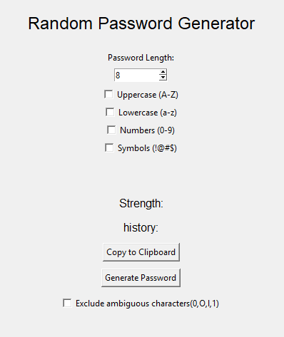
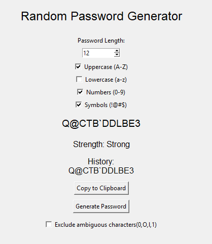
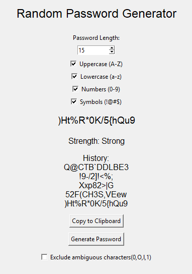

# 🔐 Random Password Generator

A secure and user-friendly Random Password Generator built using Python and Tkinter.

This project generates strong random passwords based on user-selected criteria such as password length, uppercase letters, lowercase letters, numbers, and symbols.

## 📌 Internship Task

**Organization:** Oasis Infobyte  
**Internship:** Python Programming Internship  
**Task:** Task 3 – Random Password Generator  
**Level:** Advanced

## 🟢 Beginner Version

The Beginner version is a command-line based Random Password Generator built using Python.

### Features

- Generate random passwords using Python
- User-defined password length
- Uses uppercase and lowercase letters
- Includes numbers and special characters
- Validates the entered password length
- Handles invalid input
- Uses Python's `random` and `string` modules

### Run Beginner Version

python password_generator.py

## 🔵 Advanced Version

The Advanced version is a graphical password generator built using Python and Tkinter.

It provides a user-friendly interface with additional security and convenience features such as password strength detection, clipboard support, ambiguous character exclusion, and password history.

### Advanced Features

- Graphical User Interface using Tkinter
- Password length selection from 8 to 50 characters
- Character type selection using checkboxes
- Minimum two character types required
- At least one character from each selected type
- Secure password generation using `secrets`
- Password strength indicator
- Automatic clipboard copying
- Copy to Clipboard button
- Exclude ambiguous characters
- Last 5 generated passwords stored in session history

## ✨ Features

- Generate secure random passwords
- Select password length from 8 to 50 characters
- Choose character types:
  - Uppercase letters (A-Z)
  - Lowercase letters (a-z)
  - Numbers (0-9)
  - Symbols (!@#$)
- Requires at least two character types
- Guarantees at least one character from each selected type
- Uses Python's `secrets` module for secure password generation
- Password strength indicator
- Exclude ambiguous characters (0, O, l, 1)
- Automatically copies generated passwords to the clipboard
- Copy to Clipboard button
- Stores the last 5 generated passwords during the current session
- User-friendly graphical interface using Tkinter

## 🛠️ Technologies Used

- Python
- Tkinter
- Secrets
- String
- Pyperclip

## 📂 Project Structure

Random-Password-Generator/
│
├── password_generator.py
├── password_generator_advanced.py
└── README.md

## ⚙️ Requirements

- Python 3.x
- Pyperclip

Install Pyperclip using:
pip install pyperclip

````

## ▶️ How to Run

1. Clone or download this project.
2. Open the project folder in VS Code.
3. Open the terminal.
4. Run the following command:

```bash
python password_generator_advance.py
````

## 🖥️ How to Use

1. Select the required password length.
2. Select at least two character types.
3. Enable **Exclude ambiguous characters** if required.
4. Click **Generate Password**.
5. The generated password will be displayed.
6. The password is automatically copied to the clipboard.
7. Use **Copy to Clipboard** if you want to copy it again.
8. Check the password strength indicator.
9. View the last 5 generated passwords in the History section.

## 🔒 Security

This project uses Python's `secrets` module instead of the standard `random` module for password generation.

The `secrets` module is designed for generating cryptographically strong random values and is more suitable for security-sensitive applications such as password generation.

Password history is stored only temporarily during the current program session and is not saved to a file.

## 📸 Screenshots

### Main Interface



### Generated Password



### Password History



## 🎥 Demo Video

[Watch Project Demo](Random-Password-Generator-Demo.mp4)

## 📚 Learning Outcomes

Through this project, I learned and practiced:

- Python programming
- Functions
- Conditional statements
- Lists
- Loops
- String manipulation
- Tkinter GUI development
- Secure random password generation
- Clipboard handling
- Password strength evaluation
- Git and GitHub project organization

## 👨‍💻 Author

**Rohan Baban Nanaware**

BCA Student  
Python Programming Intern – Oasis Infobyte

## 📄 Internship

This project was developed as part of the **Oasis Infobyte Python Programming Internship**.

**Task:** Task 3 – Random Password Generator  
**Level:** Advanced
